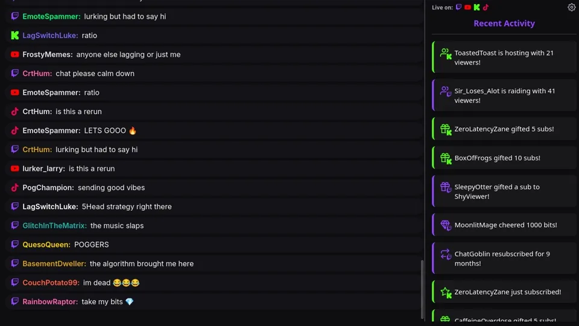
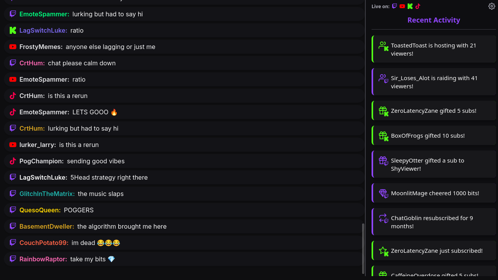
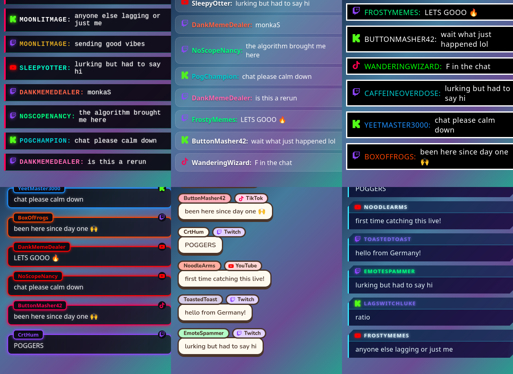
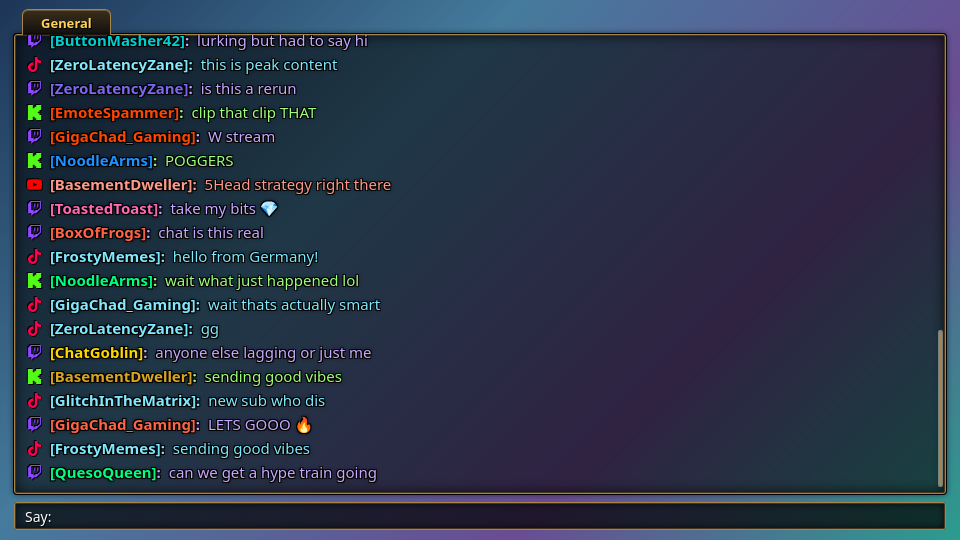
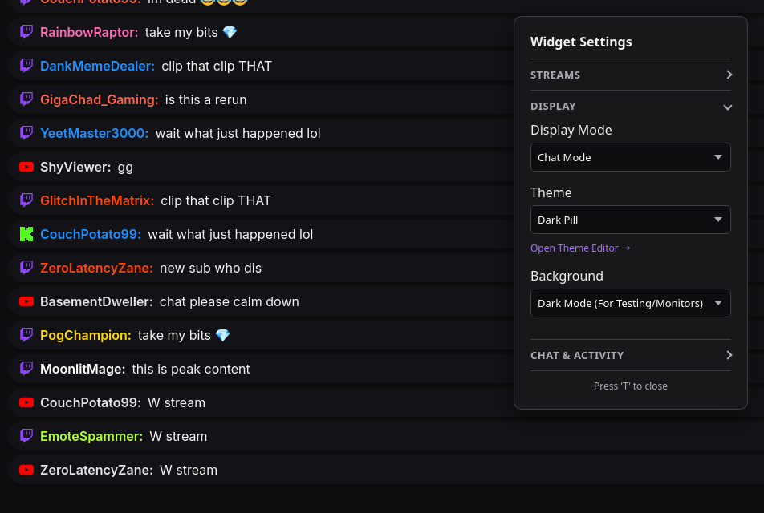
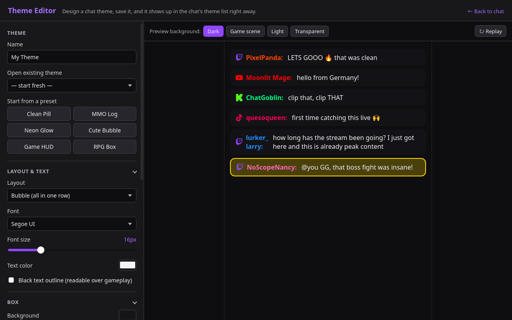

# Multi-Chat Stream Widget

Twitch, YouTube, Kick and TikTok chat in one feed, for OBS and your desktop.

**[Download the latest release](../../releases/latest)** for Windows, macOS or Linux.



## Features
* One chronological feed for Twitch, YouTube, Kick and TikTok
* Twitch, Kick, YouTube, 7TV, BTTV and FFZ emotes
* **Widget**, **Chat** and **Streamer** mode (chat plus subs, gifts, raids, Super Chats)
* 9 themes, a theme editor with live preview, and custom CSS with hot reload
* Mention highlighting, auto-reconnect, and a virtual mode with simulated chat

## Screenshots
<details>
<summary><b>Streamer Mode</b></summary>


</details>

<details>
<summary><b>Themes</b></summary>


</details>

<details>
<summary><b>MMO Chat Log</b> in Chat Mode</summary>


</details>

<details>
<summary><b>Settings</b></summary>


</details>

<details>
<summary><b>Theme editor</b></summary>


</details>

## Install
* **Windows:** `Multi-Chat_<version>_x64-setup.exe`, or `Multi-Chat-portable-windows-x64.exe` to run without installing.
* **macOS:** `Multi-Chat_<version>_aarch64.dmg`. The app isn't signed, so right-click it and choose "Open" the first time.
* **Linux:** `.AppImage` (`chmod +x`, then run) or `.deb`.

On first start, enter your channels. Press `T` anytime to change channels, theme or mode.

## OBS
Add a **Browser Source** with the URL `http://localhost:41414`.

URL parameters override the look for that source only:

`http://localhost:41414/?mode=widget&theme=mmo-log&bg=transparent`

| Parameter | Values |
|---|---|
| `mode` | `widget`, `chat`, `streamer` |
| `theme` | `dark-pill`, `cyberpunk`, `glassmorphic`, `retro-arcade`, `mmo-log`, `rpg-dialog`, `neon-tag`, `cozy-pastel`, `scifi-hud`, `custom-<name>` |
| `bg` | `transparent`, `dark` |
| `pos` | `left`, `right` (activity feed) |

## Platforms
* **Twitch:** username.
* **YouTube:** channel ID (`UC…`) or live video URL.
* **Kick:** username.
* **TikTok:** `@username`. Connects through the third-party [Euler Stream](https://www.eulerstream.com/) sign server, which receives the room id. Add `"tiktokSignApiKey"` to `config.json` if you hit its rate limit.

## Custom themes
Use the theme editor (*Settings → Display → Open Theme Editor*), or drop a `.css` file into `custom-themes/` in the data folder. See [`public/themes/`](public/themes) for examples.

## Data folder and options
Settings live in `%APPDATA%\multi-chat` (Windows), `~/Library/Application Support/multi-chat` (macOS) or `~/.config/multi-chat` (Linux). A `config.json` next to the executable makes it portable.

```
--virtual            simulated chat, no platform connections
--port=<port>        default 41414
--data-dir=<path>    custom data folder
```

## Build from source
Needs [Rust](https://rustup.rs/), the [Tauri prerequisites](https://tauri.app/start/prerequisites/) and `cargo install tauri-cli --version "^2" --locked`.

```bash
cargo tauri dev -- -- --virtual    # run with simulated chat
cargo test --workspace             # tests
cargo tauri build                  # bundles in target/release/bundle/
```

Headless server without a window: `cargo run --release -p multichat-core --bin multichat-server`
